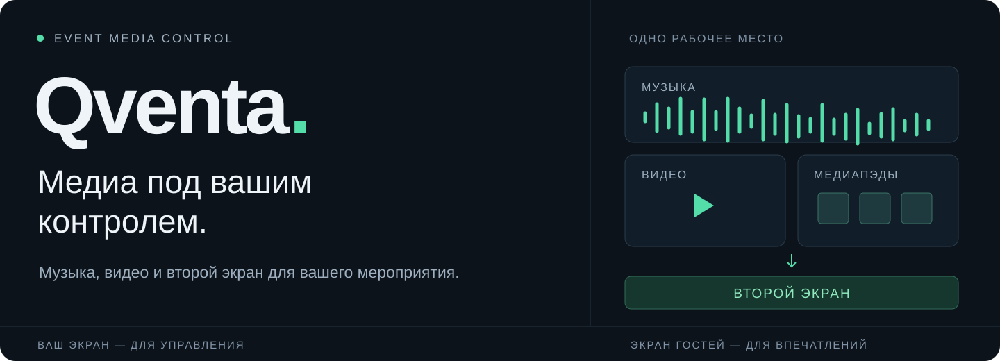

### Всё внимание — мероприятию.
Музыка, видео, быстрые запуски и экран гостей — в одном приложении Windows.

[Последняя версия](https://github.com/xook303/qventa-releases/releases/latest) · [Все релизы](https://github.com/xook303/qventa-releases/releases) · [Сообщить о проблеме](https://github.com/xook303/qventa-releases/issues)

---

## Один оператор. Одно рабочее место.

Подготовьте медиа заранее, соберите плейлисты и управляйте воспроизведением во время мероприятия. **На вашем экране — управление. На экране гостей — выбранный контент.**

| Подготовьте | Запускайте | Показывайте |
| :--- | :--- | :--- |
| **Файловый менеджер** — найдите аудио, видео и изображения в медиатеке и папках Windows. | **Медиаплеер** — переключайте треки, управляйте громкостью и воспроизведением. | **Второй экран** — выводите гостям видео, изображения и заставку мероприятия. |
| **Плейлисты** — соберите музыку и видеоклипы в нужном порядке. | **Медиапэды** — держите короткие звуки и быстрые запуски под рукой. | **Предпросмотр** — проверьте файл перед выбором назначения. |

## От подготовки к проведению

**01 · Соберите материалы.** Добавьте файлы, подготовьте плейлисты и действия сцены.

**02 · Настройте вывод.** Выберите экран для гостей и заставку — изображение или зацикленное видео.

**03 · Управляйте моментом.** Запускайте медиа из плеера и пэдов, переключайте контент и контролируйте воспроизведение со своего экрана.

---

## Установить Qventa

1. [Скачайте веб-установщик QventaSetup.exe](https://github.com/xook303/qventa-releases/releases/latest/download/QventaSetup.exe).
2. Запустите его: он выберет последнюю стабильную версию и загрузит полный пакет.
3. Завершите установку и откройте **Qventa** через ярлык.

Нужен полный пакет для переноса на другой компьютер? Откройте [последний релиз](https://github.com/xook303/qventa-releases/releases/latest) и скачайте **`Qventa_<версия>_x64-setup.exe`**.

### Уже пользуетесь программой?

Проверьте обновления в настройках. После скачивания и вашего подтверждения установщик запустится при выходе из программы. Выберите для обновления время вне рабочего мероприятия.

<b>Проверка файлов, совместимость и системные уведомления</b>

Веб-установщик и программа проверяют подпись метаданных Ed25519 и SHA-256 скачанного пакета. Это отдельная проверка целостности: **подписи Windows Authenticode пока нет**, поэтому Windows может показать «Неизвестный издатель».

Qventa продолжает Event Studia. Для прежних обновляторов сохранены технические имена `EventStudiaSetup.exe` и `EventStudia_<версия>_x64-setup.exe`. В новых релизах это те же установщики Qventa. Предыдущие выпуски хранятся как исторические сборки.

Музыкальное лото поставляется отдельно и не входит в публичный установщик.

## Каждый выпуск — с описанием изменений

В [релизах](https://github.com/xook303/qventa-releases/releases) доступны установщики, контрольные суммы и заметки на русском и английском. При сообщении о проблеме укажите версию Qventa и действия, после которых она возникла.

---

**Qventa** · Музыка. Видео. Ваше мероприятие.

[Скачать для Windows](https://github.com/xook303/qventa-releases/releases/latest/download/QventaSetup.exe) · [Открыть релизы](https://github.com/xook303/qventa-releases/releases) · [Проект](https://github.com/xook303/qventa)

English

**Qventa brings music, video, quick media triggers and audience-screen control into one Windows workspace.** Prepare your files and playlists, control playback on your own screen, and present selected content to your audience.

[Download the web installer](https://github.com/xook303/qventa-releases/releases/latest/download/QventaSetup.exe) or choose the full Windows x64 installer from the [latest release](https://github.com/xook303/qventa-releases/releases/latest).

Update metadata and package integrity are verified. Windows Authenticode signing is not currently provided. Legacy Event Studia package names remain compatible aliases for older updaters. Music Lotto is distributed separately.

