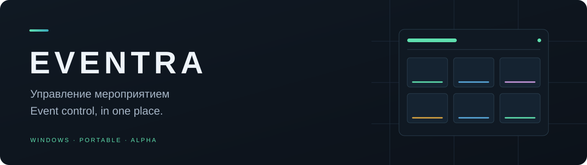

**Музыка · Видео · Сцены · Второй экран**  
**Music · Video · Scenes · Audience display**

[Русский](#ru) · [English](#en) · [Релизы / Releases](https://github.com/xook303/eventra-releases/releases)

---

## Eventra — управление мероприятием

Настольное приложение для подготовки и проведения мероприятий. Соберите медиа, подготовьте сцены и управляйте показом из одного рабочего пространства.

| Рабочая область | Для чего |
| :--- | :--- |
| **Медиатека и плеер** | Файлы, коллекции, плейлисты и воспроизведение |
| **Сцены** | Последовательность действий и запуск следующего шага через GO |
| **Media Pads** | Быстрый запуск аудио и видео из общих банков и банков сцен |
| **Второй экран** | Видео, изображения, PDF и заставка для зрителей |
| **Модули** | Таймер и вспомогательные инструменты |

### Скачать и запустить

**[Открыть страницу релизов →](https://github.com/xook303/eventra-releases/releases)**

Публичное скачивание временно приостановлено: готовится обновлённый пакет. Доступные сборки появятся на странице релизов после проверки.

1. Скачайте `Eventra-VERSION-windows-x64-portable.zip` из раздела **Assets** нужного релиза.
2. Распакуйте архив целиком в отдельную папку.
3. Запустите `Eventra.exe` из распакованной папки.

Не переносите EXE отдельно: рядом должны остаться библиотеки FFmpeg, среда WebView2 и остальные файлы пакета. Проекты и свои медиа храните вне папки программы.

### Что нового в 0.1.1

- Настроен источник обновлений через GitHub Releases.
- Добавлены доверенный публичный ключ и проверка Ed25519-подписи пакета.
- В «Справке» появилась команда **«Проверить обновления»**.
- В настройках обновлений доступны версия, каналы Stable/Beta и прогресс загрузки.
- При установке сохраняются резервная версия и журнал операции.
- Исправлено восстановление банка пэдов по умолчанию.

### Как обновлять

Откройте **«Справка → Проверить обновления»**, скачайте доступную версию и дождитесь проверки пакета. Сохраните проект, остановите медиа, завершите активный сеанс и закройте второй экран. Подтвердите **«Установить при выходе»**, затем закройте Eventra обычным способом.

Установка выполняется после выхода. Программа не закрывается автоматически во время мероприятия. Сборки без настроенного источника обновлений необходимо сначала заменить вручную на полный настроенный пакет.

### Статус и обратная связь

**Alpha для тестирования на Windows x64.** Проверка на чистой Windows 10/11 и в полном живом мероприятии ещё не завершена. Перед обновлением сохраняйте отдельную копию проекта.

При сообщении об ошибке укажите версию Eventra, версию Windows, шаги воспроизведения и точный текст ошибки. Не публикуйте личные проекты, медиа и конфиденциальные журналы.

Этот репозиторий содержит дистрибутивы и информацию об обновлениях. Исходный код здесь не публикуется. Сведения о сторонних компонентах и их лицензиях находятся в пакете.

---

## Eventra — event control, in one place

A desktop application for preparing and running events. Organize media, prepare scenes, and control your audience display from one workspace.

| Workspace | Purpose |
| :--- | :--- |
| **Media library & player** | Files, collections, playlists, and playback |
| **Scenes** | Action sequences with GO to trigger the next step |
| **Media Pads** | Quick audio and video cues from shared and scene banks |
| **Audience display** | Video, images, PDF, and an event splash screen |
| **Modules** | A timer and supporting tools |

### Download and run

**[Browse releases →](https://github.com/xook303/eventra-releases/releases)**

Public downloads are temporarily paused while an updated package is prepared. Builds will appear on the releases page after validation.

1. Download `Eventra-VERSION-windows-x64-portable.zip` from the release **Assets**.
2. Extract the entire archive into a separate folder.
3. Run `Eventra.exe` from that folder.

Keep FFmpeg libraries, WebView2, and all other package files beside the application. Store your projects and media outside the application folder.

### New in 0.1.1

- A GitHub Releases update source is configured.
- A trusted public key verifies Ed25519-signed update packages.
- **Check for updates** is available in the Help menu.
- Update settings show the version, Stable/Beta channels, and download progress.
- Installation keeps a backup of the previous version and a transaction log.
- Default media-pad bank restoration is fixed.

### Updating

Open **Help → Check for updates**, download the available version, and wait for package verification. Save your project, stop playback, end the active session, and close the audience display. Confirm **Install on exit**, then close Eventra normally.

Installation runs after exit. Eventra does not automatically close during an event. Older builds without an update source require an initial manual replacement with the complete configured package.

### Status and feedback

**Windows x64 Alpha for testing.** Clean Windows 10/11 and full live-event validation are not yet complete. Keep a separate project backup before updating.

When reporting a problem, include the Eventra version, Windows version, reproduction steps, and the exact error message. Do not publish personal projects, media, or confidential logs.

This repository hosts distributions and update information. Source code is not published here. Third-party component and license information is included in the package.

---

**EVENTRA** · Подготовьте. Запустите. Управляйте.  
Prepare. Run. Control.

